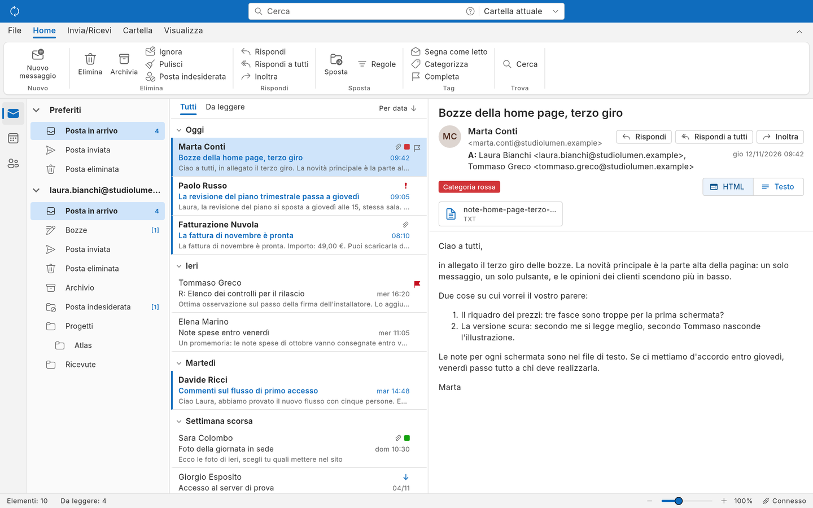
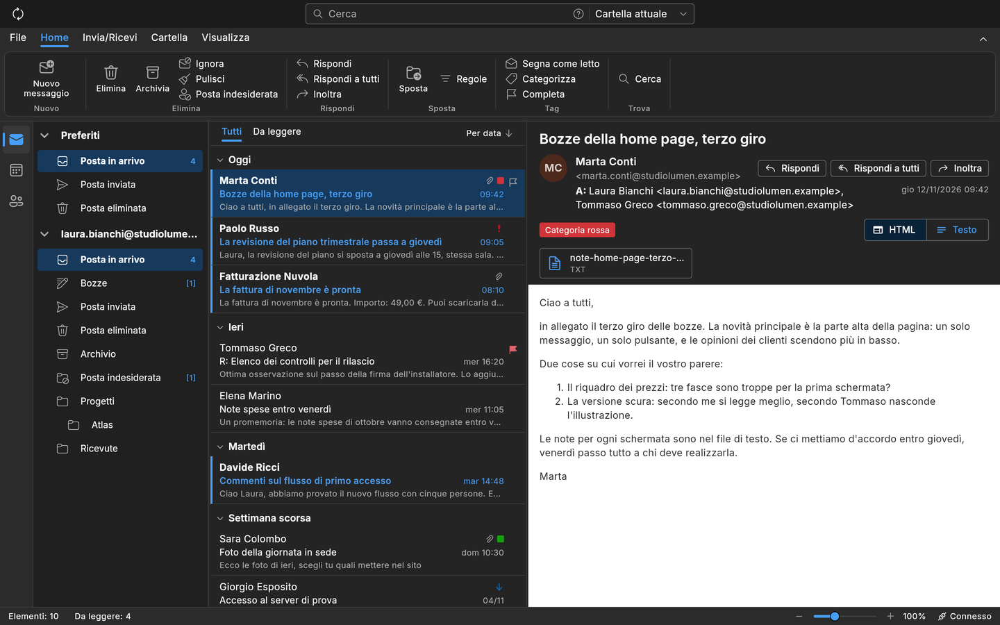
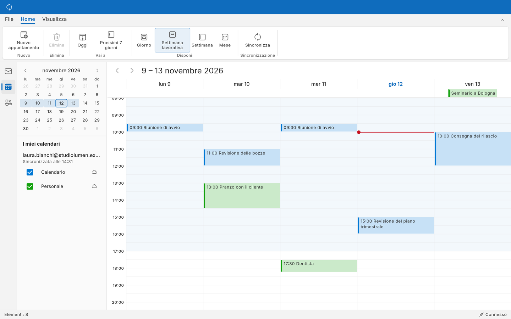

# PostinoVip

Client di posta desktop per **Linux** e **Windows** (macOS in futuro), libero e open source, con l'aspetto e i comandi
dell'**Outlook classico per desktop**: barra multifunzione, Preferiti, lista con i gruppi per data, riquadro di lettura,
calendario e contatti.

> **Versione alpha.** PostinoVip è un progetto personale e di studio. Lo uso ogni giorno, ma è stato provato con pochi
> server: prima di usarlo con la tua posta di lavoro leggi i [limiti](#limiti-noti) e comincia con un account di prova.
> Nessuna garanzia (vedi [Licenza](#licenza)).

*English summary: [below](#english).*



## Cosa fa

- **Posta**: IMAP e POP3, più account, invio SMTP; connessioni cifrate (SSL/TLS o STARTTLS obbligatorio), certificati
  sempre verificati (un certificato autofirmato si accetta solo dopo conferma, per impronta).
- **Copia locale** della posta (SQLite con indice di ricerca): le mail si aprono subito, si cercano in un attimo e restano
  leggibili senza rete; le mail inviate senza rete aspettano nella Posta in uscita.
- **Come Outlook**: conversazioni, categorie e contrassegni, regole, risposte automatiche, posta indesiderata, Archivia,
  Ignora e Pulisci conversazione, firme, testo formattato, conferme di lettura, file `.eml`, stampa in PDF.
- **Calendario** (CalDAV, viste Giorno / Settimana / Mese, ricorrenze, promemoria) e **contatti** (CardDAV, vista
  Persone, completamento degli indirizzi).
- **Gmail** con l'accesso di Google (OAuth2) al posto della password, anche per calendario e contatti.
- Aspetto dell'Outlook classico di oggi, con cinque temi (chiari e scuri) e la barra multifunzione classica o
  semplificata. Il testo delle mail HTML è sempre su fondo bianco e senza JavaScript; le immagini remote sono bloccate
  finché non le sblocchi.

| Tema scuro | Calendario |
|---|---|
|  |  |

Le schermate mostrano una casella d'esempio inventata e si rifanno con `tools/schermate.sh`.

## Limiti noti

- Provato a fondo con **un solo server** (IceWarp) e con Gmail. Spostare ed eliminare mail su altri server (Dovecot,
  Exchange, …) dovrebbe funzionare ma non è stato provato.
- **Windows** provato poco, **macOS** mai.
- **Microsoft 365 / Outlook.com** con OAuth2: il codice c'è, ma non è stato provato con un account vero.
- **Gmail**: serve un'app registrata nella console di Google (vedi [Gmail e OAuth2](#gmail-e-oauth2)); il repository non
  ne contiene una.
- Gli installer non sono firmati: Windows SmartScreen chiede una conferma al primo avvio.
- Interfaccia solo in italiano.

## Come è fatto

Due programmi sullo stesso computer: un'**interfaccia in Flutter** (`app/`) e un **core in C#** (.NET 10, MailKit/MimeKit,
`core/`) che parla con i server di posta. L'utente avvia solo l'interfaccia, che avvia e ferma il core. Il core ascolta
**solo su 127.0.0.1**, con una porta e un token casuali a ogni avvio.

Documentazione per chi sviluppa (in italiano): [`docs/api.md`](docs/api.md) (endpoint del core),
[`docs/architettura.html`](docs/architettura.html) (guida con schema interattivo), [`docs/storia.md`](docs/storia.md)
(il diario di sviluppo, passo per passo), [`CLAUDE.md`](CLAUDE.md) (brief del progetto e stato).

## Compilare

Requisiti: **.NET SDK 10**, **Flutter 3.47** (canale stable) con il supporto desktop; su Linux anche
`libsecret-1-dev` (portachiavi) e le dipendenze di Flutter per Linux (`clang`, `cmake`, `ninja-build`, `pkg-config`,
`libgtk-3-dev`); su Windows Visual Studio con «Sviluppo di applicazioni desktop con C++».

```bash
cd core && dotnet build && dotnet test      # core e test
cd ../app && flutter test                   # test dell'app
flutter run -d linux                        # avvia l'app (che avvia il core compilato); su Windows: -d windows
```

Al primo avvio una finestra chiede l'account. Per lo sviluppo si possono usare anche i `dotnet user-secrets` del core
(`Imap:Host`, `Imap:Username`, `Imap:Password`, `Smtp:Host`): **mai credenziali nei file del repository**.

### Pacchetti

```bash
packaging/linux/build-deb.sh          # dist/linux/postinovip_<versione>_amd64.deb
packaging/linux/build-appimage.sh     # dist/linux/PostinoVip-<versione>-x86_64.AppImage (scarica appimagetool, verificato con SHA-256)
```
```powershell
# Windows, con Inno Setup 6:
powershell -ExecutionPolicy Bypass -File packaging\windows\build-installer.ps1   # dist\windows\PostinoVip-Setup-<versione>.exe
```

I pacchetti contengono il core già compilato (`--self-contained`): non serve installare .NET.

### Gmail e OAuth2

Per l'accesso con Google serve un'app registrata da chi compila PostinoVip: nella [console di Google Cloud](https://console.cloud.google.com/)
crea un client OAuth di tipo **App desktop**, attiva le API «CardDAV» e «CalDAV» se vuoi contatti e calendario, e scrivi
ID e segreto in `core/src/PostinoVip.Api/oauth-clients.json` (escluso da git; gli script dei pacchetti lo includono):

```json
{ "OAuth": { "Google": { "ClientId": "…apps.googleusercontent.com", "ClientSecret": "…" } } }
```

Finché l'app Google è in modalità «Testing» possono accedere solo gli utenti di prova indicati nella console, e l'accesso
va rifatto ogni 7 giorni. Per Microsoft la sezione è `OAuth:Microsoft:ClientId` (app registrata in Microsoft Entra).

## Dati e privacy

- Account e password stanno nell'**archivio sicuro** del sistema: il portachiavi (libsecret) su Linux; su Windows un file
  cifrato (AES-GCM) la cui chiave è custodita nel Credential Manager (`flutter_secure_storage`).
- La copia locale della posta, i contatti e i calendari stanno nel profilo dell'utente: `~/.local/share/postinovip`
  su Linux, `%LOCALAPPDATA%\postinovip` su Windows (cartelle leggibili solo dall'utente; non cifrate dall'app: vale la
  cifratura del disco).
- PostinoVip si collega solo ai server dei tuoi account (e, per Gmail, ai servizi di accesso di Google). Nessuna
  telemetria.

## Sicurezza

Per segnalare un problema di sicurezza vedi [SECURITY.md](SECURITY.md).

## Contribuire

È un progetto personale: le segnalazioni (issue) sono benvenute; le proposte di modifica vengono valutate, ma lo sviluppo
avviene in un repository privato e le versioni pubblicate qui arrivano a blocchi.

## Licenza

© 2026 Marcello Anderlini.
PostinoVip è software libero, distribuito secondo i termini della
[GNU Affero General Public License v3.0 o successiva](LICENSE) (AGPL-3.0-or-later),
SENZA ALCUNA GARANZIA. Le licenze delle librerie incluse sono nell'app
(menu ⋮ → Informazioni su PostinoVip → Visualizza licenze). Il carattere Inter è distribuito con la SIL Open Font
License 1.1; le icone sono le Fluent UI System Icons (licenza MIT).

PostinoVip non è affiliato a Microsoft né da essa approvato; Outlook, Office e Microsoft 365 sono marchi di Microsoft
Corporation, citati solo per descrivere a cosa si ispira il programma.

---

## English


**PostinoVip** is a free and open-source desktop mail client for **Linux** and **Windows**, modelled on the look and
commands of **classic Outlook for desktop**: ribbon, Favorites, message list grouped by date, reading pane, calendar and
contacts.

> **Alpha.** A personal and learning project. I use it daily, but it has been tested with few servers: read the known
> limits above and start with a test account. No warranty. The user interface is in **Italian only**.

- IMAP, POP3 and SMTP with multiple accounts; encrypted connections and strict certificate checks.
- A local copy of your mail (SQLite with full-text search): fast, searchable, readable offline; an Outbox for mail sent
  while offline.
- Rules, automatic replies, junk mail, Archive, Ignore/Clean Up conversation, signatures, rich text, read receipts,
  `.eml` files, PDF printing.
- Calendar (CalDAV) and contacts (CardDAV); Gmail sign-in with OAuth2 (you need your own Google OAuth client in
  `core/src/PostinoVip.Api/oauth-clients.json`, see the Italian section).
- Architecture: a Flutter UI (`app/`) and a C# core (.NET 10, MailKit, `core/`) listening on 127.0.0.1 only, started and
  stopped by the UI.

Build: .NET SDK 10 and Flutter 3.47; on Linux also `libsecret-1-dev` and Flutter's Linux dependencies. Then
`cd core && dotnet build`, `cd app && flutter run -d linux` (or `-d windows`). Packages: `packaging/linux/build-deb.sh`,
`packaging/linux/build-appimage.sh`, `packaging\windows\build-installer.ps1`.

Security issues: see [SECURITY.md](SECURITY.md). License: [AGPL-3.0-or-later](LICENSE). Not affiliated with or endorsed
by Microsoft; Outlook, Office and Microsoft 365 are trademarks of Microsoft Corporation.
